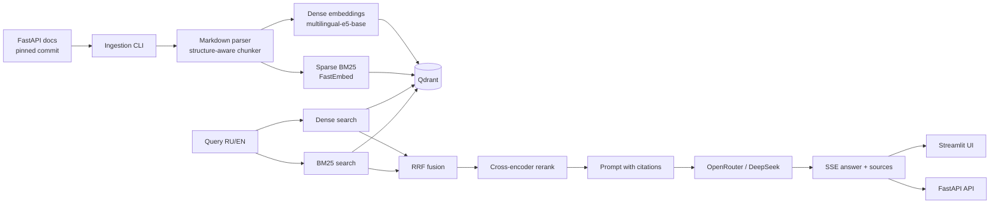

# Архитектура

## Поток данных



## Компоненты

- **Ingestion** — загрузка Markdown-документации по pinned commit, фильтрация служебных страниц, очистка frontmatter и HTML, чанкинг по структуре заголовков с сохранением code fences.
- **Retrieval** — Qdrant с двумя named vectors: dense и sparse.
- **Fusion** — RRF поверх dense- и BM25-кандидатов.
- **Reranking** — cross-encoder для финального top-k.
- **Generation** — ответ только по найденному контексту, с цитатами на разделы документации.
- **API** — FastAPI с SSE-стримингом.
- **UI** — Streamlit: чат и сравнение режимов поиска.

## Ingestion

```text
config/ingestion.toml
  → GitHub tarball @ pinned SHA
  → docs/en/docs/**/*.md + docs_src/**
  → filter + frontmatter/HTML cleanup + include resolution
  → heading-aware sections
  → block-based chunks (max 350 approx tokens, overlap 50)
  → data/chunks/chunks.jsonl + stats.json
```

Каждый чанк хранит `url`, `title`, `heading_path`, `section`, `content_type`,
`version`, `content_hash` и `token_count`. Это позволит на этапе retrieval
фильтровать по разделу и строить цитаты без дополнительных запросов.

## Retrieval

```text
query (RU/EN)
  ├─ e5 query embedding ──> dense search ─┐
  └─ BM25 query vector ───> sparse search ─┤
                                            ├─ RRF fusion ─> top-k
                                            └─ filters: section, content_type,
                                               language, version, path
```

Qdrant collection:

- `dense`: 768 dim, cosine, `multilingual-e5-base`;
- `sparse`: BM25 + IDF;
- point ID = UUID чанка;
- payload indexes по метаданным.

Индексация идемпотентна: повторный upsert обновляет точки по UUID, а stale points
удаляются после успешной записи. Полная пересборка — `--recreate`.


## Принципы

- `main` обновляется только через merge веток этапов.
- Секреты живут только в `.env`.
- Тесты не требуют API-ключа: LLM подменяется заглушкой.
- Все результаты eval воспроизводимы и хранятся в репозитории.
