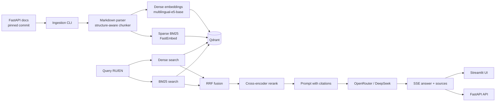

# Архитектура

## Поток данных

## Компоненты

- **Ingestion** — загрузка Markdown-документации, фильтрация служебных страниц, чанкинг по структуре заголовков.
- **Retrieval** — Qdrant с двумя named vectors: dense и sparse.
- **Fusion** — RRF поверх dense- и BM25-кандидатов.
- **Reranking** — cross-encoder для финального top-k.
- **Generation** — ответ только по найденному контексту, с цитатами на разделы документации.
- **API** — FastAPI с SSE-стримингом.
- **UI** — Streamlit: чат и сравнение режимов поиска.

## Принципы

- `main` обновляется только через merge веток этапов.
- Секреты живут только в `.env`.
- Тесты не требуют API-ключа: LLM подменяется заглушкой.
- Все результаты eval воспроизводимы и хранятся в репозитории.
